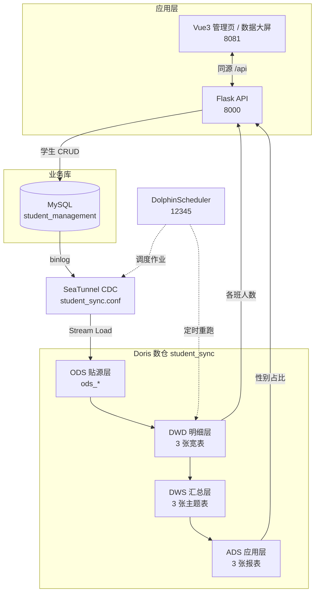

# student-doris · 学生管理系统全链路数据平台

一套端到端可复现的课程实践项目：**MySQL 业务库 → SeaTunnel CDC → Doris 四层数仓 → Vue3 + Flask 应用与可视化大屏**。

管理页里新增、修改或删除一名学生，变更会被 binlog 捕获，实时同步进 Doris 的 ODS 层，再由 DolphinScheduler 定时重跑分层脚本，最终反映到「各班人数」和「性别占比」两张图表上。项目不依赖 Superset，也不新建孤立库表：前后端直接读写已有的业务库与数仓表，所有环节共用一条数据链路。

---

## 目录

- [1. 项目定位](#1-项目定位)
- [2. 架构与数据流](#2-架构与数据流)
- [3. 技术栈](#3-技术栈)
- [4. 目录结构](#4-目录结构)
- [5. 快速开始](#5-快速开始)
- [6. 数仓分层设计](#6-数仓分层设计)
- [7. 应用与接口](#7-应用与接口)
- [8. 全链路验证](#8-全链路验证)
- [9. 关键设计决策](#9-关键设计决策)
- [10. 配置约定与示例凭据](#10-配置约定与示例凭据)
- [11. 常见问题](#11-常见问题)
- [12. 文档导航](#12-文档导航)

---

## 1. 项目定位

很多课程项目把「业务系统」和「数仓」做成两套互不相关的演示：管理页写一张自建的样例表，大屏读另一张手填的统计表，数字看着对得上，链路其实是断的。这个项目要解决的就是这件事。

| 目标 | 做法 |
|---|---|
| 数据只有一份源头 | 前后端 CRUD 直接写 `student_management.student`（真实业务源表），不另建应用库 |
| 同步是实时的 | SeaTunnel MySQL-CDC 常驻监听 binlog，把 10 张源表镜像到 `student_sync.ods_*` |
| 分层是自动的 | DolphinScheduler 定时执行 `warehouse/run_layers.sh`，幂等重建 DWD / DWS / ADS |
| 大屏读的是数仓 | 班级人数取 DWD 明细层，性别占比取 ADS 应用层，不读业务库、不算假数据 |
| 演示数据够真实 | 10 张源表、约 800 名学生、3000 余条选课与考勤记录，由脚本生成且外键自洽 |

---

## 2. 架构与数据流



| 顺序 | 环节 | 组件 | 对应目录 | 关键产物 |
|---|---|---|---|---|
| ① | 业务源库 | MySQL 8.0 | `source-mysql/` | 10 张表、约 800 名学生 |
| ② | 实时同步 | SeaTunnel 2.3.9 | `seatunnel/` | `student_sync.ods_*` 10 张贴源表 |
| ③ | 数仓分层 | Doris 2.1.x | `warehouse/` | DWD 3 张、DWS 3 张、ADS 3 张 |
| ④ | 任务调度 | DolphinScheduler 3.2.2 | `dolphinscheduler/` | 定时触发分层与 CDC 作业 |
| ⑤ | 业务应用 | Vue3 + ECharts + Flask | `webapp/` | 管理页、大屏、REST API |
| — | 运行环境 | Docker Compose | `infra/` | Doris FE / BE + SeaTunnel 容器 |

---

## 3. 技术栈

| 层次 | 技术 | 版本 / 说明 |
|---|---|---|
| 业务库 | MySQL | 8.0，InnoDB，utf8mb4 |
| 实时同步 | Apache SeaTunnel | 2.3.9，MySQL-CDC + Doris Sink，`STREAMING` 模式 |
| 数仓 | Apache Doris | 2.1.9，单 FE + 单 BE，UNIQUE KEY 模型 |
| 调度 | Apache DolphinScheduler | 3.2.2 Standalone，元数据存外部 MySQL |
| 后端 | Flask + Flask-CORS + PyMySQL | Python 3.11，开启跨域 |
| 前端 | Vue3 + ECharts + axios + Element Plus 风格样式 | UMD 本地依赖，无需 npm 构建 |
| Web 服务 | nginx | 静态资源 + `/api` 反向代理 |
| 编排 | Docker Compose | 复用已有容器，不新建数据库服务 |

---

## 4. 目录结构

```
student-doris/
├── README.md                      # 本文：项目总览与快速开始
├── .gitignore
├── docs/
│   ├── architecture.md            # 分层设计、字段映射、指标口径、踩坑记录
│   └── deployment.md              # 分步部署、调度配置、排错清单
├── source-mysql/                  # ① 业务源库
│   ├── student_management.sql     #   建库 + 10 张表 + 基础演示数据
│   ├── gen_student_data.py        #   批量数据生成器（可重复执行、不覆盖基础数据）
│   └── student_bulk_data.sql      #   生成结果：约 1 万行 INSERT
├── seatunnel/                     # ② 实时同步
│   ├── student_sync.conf          #   MySQL-CDC → Doris ODS 作业配置
│   └── run_cdc.sh                 #   一键启动常驻作业（含网络与重复启动检查）
├── warehouse/                     # ③ 数仓分层
│   ├── student_layers.sql         #   DWD / DWS / ADS 建表与灌数（幂等）
│   └── run_layers.sh              #   一键执行 + 行数验收 + 抽样核对
├── dolphinscheduler/              # ④ 任务调度
│   ├── docker-compose.yaml        #   Standalone + 外部 MySQL 元数据
│   ├── deploy.sh                  #   幂等部署（含驱动下载与空库保护）
│   ├── run_seatunnel_job.sh       #   DS Shell 任务：调度容器内 SeaTunnel 作业
│   ├── ds_batch_demo.conf         #   批处理冒烟作业（FakeSource → Console）
│   └── README.md                  #   外部依赖获取说明
├── webapp/                        # ⑤ Vue3 + ECharts + Flask 应用
│   ├── README.md                  #   子系统专属说明与测试步骤
│   ├── docker-compose.yml         #   flask + vue 两个服务
│   ├── deploy.sh                  #   只读链路校验 + 构建重启
│   ├── backend/                   #   app.py / requirements.txt / Dockerfile
│   └── frontend/                  #   index.html / dashboard.html / js / css / vendor
└── infra/                         # 运行环境编排
    ├── docker-compose.yaml        #   Doris FE + BE + SeaTunnel 单机编排
    └── 02_load_and_start.sh       #   镜像加载与顺序启动
```

目录名按**数据流向**组织，从 `source-mysql` 一路读到 `webapp`，就能把整条链路走一遍。

---

## 5. 快速开始

### 5.1 前置条件

- 一台 Linux 主机（实验环境为一台约 7 Gi 内存的 Linux 主机），已安装 Docker 与 Docker Compose；
- 容器名 `mysql`、`doris-fe`、`doris-be`、`seatunnel` 可被同一 Docker 网络解析；
- 单机单 BE，Doris 建表必须显式写 `PROPERTIES("replication_num"="1")`，仓库中的脚本已处理；
- 云平台安全组需放行 `8081`（前端）、`8000`（后端）、`12345`（调度器 UI）、`9030`（Doris 查询）。

完整的分步说明见 [`docs/deployment.md`](docs/deployment.md)。

### 5.2 五步启动

```bash
# ① 起运行环境（Doris FE/BE + SeaTunnel，MySQL 复用已有容器）
cd infra && docker compose up -d

# ② 初始化业务源库
docker exec -i mysql mysql -uroot -p000000 \
  < source-mysql/student_management.sql
docker exec -i mysql mysql -uroot -p000000 \
  < source-mysql/student_bulk_data.sql

# ③ 建立 CDC 目标库并启动常驻同步
docker exec mysql mysql -h doris-fe -P 9030 -uroot -p000000 \
  -e "CREATE DATABASE IF NOT EXISTS student_sync;"
GRANT_SQL="GRANT PROCESS ON *.* TO 'st_user_source'@'%'; FLUSH PRIVILEGES;"
docker exec mysql mysql -uroot -p000000 -e "$GRANT_SQL"
bash seatunnel/run_cdc.sh --bg

# ④ 首次分层（后续交给 DolphinScheduler 定时重跑）
bash warehouse/run_layers.sh

# ⑤ 部署前后端应用
bash webapp/deploy.sh
```

> 第 ③ 步的账号 `st_user_source` 是 SeaTunnel CDC 专用账号；首次使用需按 `student_sync.conf` 中的口令创建。

### 5.3 一键验证

```bash
curl http://127.0.0.1:8000/api/health
curl "http://127.0.0.1:8000/api/student/list?size=3"
curl http://127.0.0.1:8000/api/chart/class
curl http://127.0.0.1:8000/api/chart/gender
```

健康检查应回显 `mysql_db=student_management`、`doris_db=student_sync`，两项状态均为 `ok`。

### 5.4 访问地址

| 入口 | 地址 |
|---|---|
| 学生管理页 | `http://<host-ip>:8081/` |
| 数据大屏 | `http://<host-ip>:8081/dashboard.html` |
| 后端接口 | `http://<host-ip>:8000/api/health` |
| 调度器 UI | `http://<host-ip>:12345/dolphinscheduler/ui` |

DolphinScheduler 默认账号 `admin / dolphinscheduler123`。浏览器只需访问 8081，页面里的 `/api` 由 nginx 反代到 `flask:8000`；8000 保留用于直接调试接口。

---

## 6. 数仓分层设计

| 层 | 定位 | 表 | 粒度与来源 |
|---|---|---|---|
| ODS | 原封不动接住业务数据 | `ods_student`、`ods_teacher`、`ods_course`、`ods_score`、`ods_classes`、`ods_college`、`ods_major`、`ods_attendance`、`ods_enrollment`、`ods_teaching_class` | 由 SeaTunnel 自动建表，结构与 MySQL 一致 |
| DWD | 清洗、规范化、维度退化 | `dwd_dim_student`、`dwd_dim_course_teacher`、`dwd_fact_student_score` | 学生宽表拉平到学院，事实表拉平到成绩明细 |
| DWS | 按主题轻度聚合 | `dws_class_course_summary`、`dws_student_score_summary`、`dws_teacher_stat` | 班级×课程、学生、教师三个主题 |
| ADS | 面向报表与大屏 | `ads_college_dashboard`、`ads_class_score_ranking`、`ads_student_warning` | 学院画像、班级排行、学业预警 |

**三处必须按真实字段做映射的地方**（凭字段名想当然会直接跑不通）：

1. `ods_student` / `ods_teacher` 的姓名列叫 `name`，不是 `student_name` / `teacher_name`；教师职称是 `title`。
2. `ods_score` 里**没有** `student_id`、`course_id`、`exam_time`，只有 `enrollment_id`。关联链是 `score → enrollment(student_id, teaching_id) → student / teaching_class → course / teacher`。因此 `score ← total_score`、`exam_time ← input_time`，学分要从 `ods_course.credit` 取。
3. 同一门课会由多位教师、在多个学期开课，所以 `dwd_dim_course_teacher` 以 `teaching_id` 为主键，不能用 `course_id`，否则会丢记录。

指标口径、窗口函数用法、幂等设计详见 [`docs/architecture.md`](docs/architecture.md)。

---

## 7. 应用与接口

前端分两页：

- **管理页** `index.html`：分页表格、关键字搜索、新增 / 编辑弹窗、删除按钮。班级字段从 `classes` 维表下拉选择（38 个班），学籍状态取源表的四种取值，编辑时学号也可修改。
- **大屏页** `dashboard.html`：各班人数柱状图（38 个班用滑块拖动查看）、性别占比饼图，页面加载自动拉取数据，另有「刷新数据」按钮和 30 秒自动刷新开关。

| 方法 | 路径 | 数据源 | 说明 |
|---|---|---|---|
| GET | `/api/health` | MySQL + Doris | 健康检查，回显当前连接的库名 |
| GET | `/api/student/classes` | MySQL | 班级下拉列表 |
| GET | `/api/student/list?keyword=&page=1&size=50` | MySQL | 分页学生列表 |
| POST | `/api/student/add` | MySQL | 新增学生 |
| PUT | `/api/student/update/<student_id>` | MySQL | 修改学生（支持只传部分字段） |
| DELETE | `/api/student/delete/<student_id>` | MySQL | 删除学生 |
| GET | `/api/chart/class` | Doris `dwd_dim_student` | 各班人数 |
| GET | `/api/chart/gender` | Doris `ads_college_dashboard` | 性别占比（按学院汇总上卷） |

统一响应为 `{"code":0,"msg":"ok","data":{...}}`，失败为 `{"code":1,"msg":"..."}`。两个图表接口都返回 `items / categories / values / total`，ECharts 可直接消费。

> 性别图读的是 ADS 现有表；ADS 三张表没有「各班人数」这个口径，且项目不新建表，因此班级图从已有的 DWD 明细层聚合。两处统计总数应一致，可交叉校验。

删除学生时要注意：`enrollment.student_id` 外键是 `CASCADE`，会连带删除该生的选课记录，并经由 CDC 同步到数仓。前端确认框和接口返回信息都已明确提示。

---

## 8. 全链路验证

下面这组命令能证明「管理页写入 → 大屏变化」不是摆设。以基线 812 人为例，实际数字请以当前库为准。

```bash
# 1. 记录基线
curl -s http://127.0.0.1:8000/api/chart/gender

# 2. 通过接口新增一名学生（class_id 取 /api/student/classes 中的真实值）
curl -X POST http://127.0.0.1:8000/api/student/add \
  -H 'Content-Type: application/json' \
  -d '{"student_no":"TESTLINK9999","name":"链路测试","gender":"男",
       "class_id":1,"enroll_date":"2026-09-01","status":"在读"}'

# 3. 等 5~10 秒，确认 binlog 已同步到 ODS
docker exec mysql mysql -h doris-fe -P 9030 -uroot -p000000 -N \
  -e "SELECT COUNT(*) FROM student_sync.ods_student;"

# 4. 重跑分层（生产环境由 DolphinScheduler 定时完成）
bash warehouse/run_layers.sh

# 5. 大屏点「刷新数据」，或直接看接口：人数应 +1
curl -s http://127.0.0.1:8000/api/chart/gender
curl -s http://127.0.0.1:8000/api/chart/class
```

已实测的完整链路：新增一名男生后，MySQL 与 ODS 同步 +1，分层重跑后性别图由 `男 432 / 女 380 / 共 812` 变为 `433 / 380 / 813`，计科 2401 班由 26 人变为 27 人；删除并重跑后完全回到基线。

---

## 9. 关键设计决策

1. **调度器用 Standalone + 外部 MySQL，而不是集群版。** 集群版需要 ZooKeeper 注册中心、`dolphinscheduler-tools` 初始化 schema、统一 `.env` 和多个 JVM 堆限制，在 7 Gi 的单机上容易 OOM。真正让「重启丢工作流」消失的是把元数据从内置 H2 换到外部 MySQL，一个容器就能做到。
2. **standalone 镜像不带 MySQL 驱动。** 官方镜像只内置 H2 驱动，需要把 `mysql-connector-j-8.0.33.jar` 挂到 `/opt/dolphinscheduler/libs/ext`，`start.sh` 会自动把该子目录加入 classpath；数据源用 `SPRING_DATASOURCE_*` 环境变量覆盖，并用 `SPRING_SQL_INIT_MODE=never` 禁止执行 H2 建表脚本。
3. **初始化 schema 只在空库时执行。** 官方 `dolphinscheduler_mysql.sql` 含 `DROP TABLE IF EXISTS`，重复执行会清空工作流。`deploy.sh` 先检查表数，为 0 才导入。
4. **单 BE 必须显式声明副本数为 1。** 所有 Doris 建表语句都带 `PROPERTIES("replication_num"="1")`，否则建表直接失败。
5. **分层脚本做成幂等。** `CREATE TABLE IF NOT EXISTS` + 灌数前 `TRUNCATE`，配合 UNIQUE KEY 按主键覆盖，重复执行不会翻倍；两个不同粒度的聚合先各自 `GROUP BY` 再 JOIN，避免笛卡尔积放大指标。
6. **ADS 学院画像以维表驱动。** 以 `ods_college` 左连接学生聚合结果，保证零学生的学院也出现在大屏里，维度完整。
7. **前端依赖本地化。** Vue3、axios、ECharts 的 UMD 文件放在 `webapp/frontend/vendor/`，由 nginx 直接提供，浏览器无需外网，也不需要 Node 构建。
8. **应用不自建库表。** CRUD 写 `student_management.student`，图表读 `student_sync` 已有分层表；`webapp/deploy.sh` 只做只读链路校验，不写入任何业务数据。

---

## 10. 配置约定与示例凭据

| 服务 | 容器内地址 | 宿主机端口 | 用途 |
|---|---|---|---|
| MySQL | `mysql:3306` | 3306 | 业务源库、DS 元数据库 |
| Doris FE | `doris-fe:9030` | 9030 | MySQL 协议查询 |
| Doris FE HTTP | `doris-fe:8030` | 8030 | Stream Load / Sink |
| Doris BE | `doris-be:8040` | 8040 | Stream Load 307 重定向目标 |
| Flask | `flask:8000` | 8000 | REST API |
| nginx / Vue | `student-vue:80` | 8081 | 静态页面与 `/api` 反代 |
| DolphinScheduler | `dolphinscheduler:12345` | 12345 | 调度器 UI |

> **关于仓库中的口令**：`000000`、`mysqlpw` 均为单机实验环境的示例值，保留在配置和脚本里是为了让课程环境可以直接复现。这些不是生产凭据，请勿在其他环境复用；正式部署应改用环境变量或密钥管理，并限制数据库账号权限。

SeaTunnel 容器必须同时接入 `doris-st_doris-net`，否则 FE 的 307 重定向指向 BE 内网地址时不可达，表现为 Stream Load 挂起、checkpoint 超时、作业被取消。`seatunnel/run_cdc.sh` 会自动检查并补接网络。

---

## 11. 常见问题

| 现象 | 原因与处理 |
|---|---|
| 管理页改了数据，大屏没变 | 分层脚本尚未重跑。检查 DS 定时任务或手动执行 `warehouse/run_layers.sh`，再点大屏「刷新数据」 |
| 改完学号，数仓没立刻更新 | CDC `checkpoint.interval=5000`，约 5~10 秒后 ODS 才刷新；同一主键在一个 checkpoint 内的多次变更会合并为最终状态 |
| Doris 建表报副本错误 | 单 BE 环境需要 `PROPERTIES("replication_num"="1")`，分层脚本已统一加上 |
| SeaTunnel 作业反复被取消 | 检查容器是否接入 `doris-st_doris-net`，以及 BE 8040 是否可达 |
| 新增学生报外键错误 | `class_id` 必须是 `classes` 表里存在的 ID；`enroll_date` 非空且无默认值，接口默认取当天 |
| DS 重启后工作流丢失 | 元数据仍在使用内置 H2。按 `dolphinscheduler/README.md` 切换到外部 MySQL |
| 页面 404 或接口 502 | 检查 `docker compose ps`，以及 `nginx.conf` 中 `proxy_pass http://flask:8000` 的容器名 |
| 本机访问不到页面 | 检查云主机安全组是否放行 8081 / 8000 / 12345 / 9030 |

---

## 12. 文档导航

| 文档 | 内容 |
|---|---|
| [`docs/architecture.md`](docs/architecture.md) | 分层设计、真实字段映射、JOIN 链、指标口径、幂等策略与踩坑记录 |
| [`docs/deployment.md`](docs/deployment.md) | 从零部署的分步命令、DolphinScheduler 工作流配置、排错清单 |
| [`webapp/README.md`](webapp/README.md) | 前后端子系统的目录、接口参数、curl 测试与浏览器验证步骤 |
| [`dolphinscheduler/README.md`](dolphinscheduler/README.md) | 调度器部署说明与外部依赖获取方式 |
